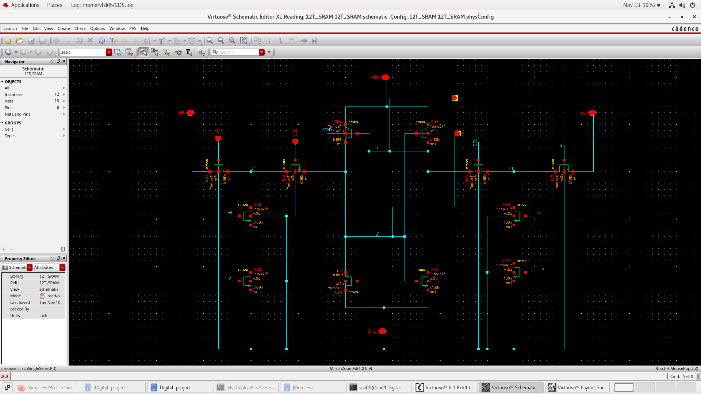
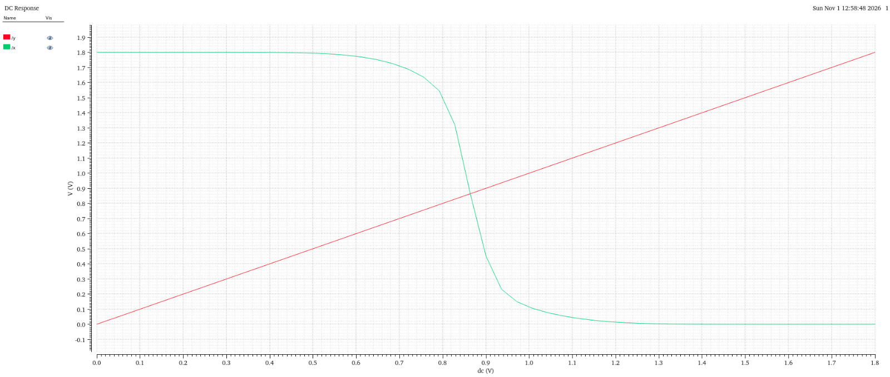

# 12T SRAM Design Using Cadence Virtuoso

<p align="center">
  
  
  
</p>

---

## Project Overview

This project focuses on the design and implementation of a **12-Transistor (12T) Static Random Access Memory (SRAM)** using Cadence Virtuoso.

The project includes SRAM schematic design, circuit simulation, functionality analysis, butterfly curve analysis, physical layout implementation, and verification using Design Rule Check (DRC) and Layout Versus Schematic (LVS).

---

## Objectives

- Design and implement a 12T SRAM cell using Cadence Virtuoso.
- Understand SRAM architecture and circuit operation.
- Implement a 4×1 SRAM configuration.
- Analyze SRAM functionality through simulation.
- Study butterfly curves for SRAM stability analysis.
- Develop the physical layout of the SRAM design.
- Perform DRC and LVS verification.

---

## Tools & Technologies

| Tool | Application |
|---|---|
| Cadence Virtuoso | Schematic and layout design |
| Analog Design Environment (ADE) | Circuit simulation |
| DRC | Design Rule Check |
| LVS | Layout Versus Schematic |

---

## Design Methodology

```text
12T SRAM Cell Design
        ↓
Schematic Implementation
        ↓
Circuit Simulation
        ↓
Functional Verification
        ↓
Butterfly Curve Analysis
        ↓
4×1 SRAM Design
        ↓
Physical Layout
        ↓
DRC Verification
        ↓
LVS Verification
```

---

# Project Images

## 1. 12T SRAM Schematic



## 2. 4×1 SRAM Design


## 3. SRAM Butterfly Curve


## 4. SRAM Functionality Simulation


## 5. Final SRAM Layout


## 6. Initial Layout – LVS


## 7. DRC Verification


## 8. Additional Design Image



---

## Physical Verification

### DRC – Design Rule Check

DRC checks whether the physical layout satisfies the specified design rules.

### LVS – Layout Versus Schematic

LVS compares the physical layout with the schematic to verify circuit connectivity and consistency.

---

## Applications

- Processor Cache Memory
- Embedded Memory Systems
- High-Speed Digital Circuits
- VLSI Systems
- Memory Subsystems

---

## Author

**Bhargav Jampana**

M.Tech – VLSI and Microelectronics  
Indian Institute of Information Technology Design and Manufacturing (IIITDM), Kurnool

---

## GitHub Repository

[12T SRAM Design Using Cadence Virtuoso](https://github.com/226ec1006-Bhargav/12T-SRAM-Cadence-Virtuoso)

---

<p align="center">
  <b>12T SRAM Design | VLSI | Cadence Virtuoso</b>
</p>

<p align="center">
  ⭐ Thank you for visiting this repository!
</p>
