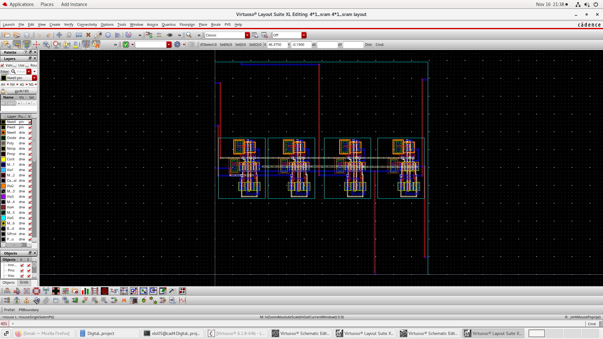

# 12T SRAM Cell Design and Layout Using Cadence Virtuoso

<p align="center">
  
  
  
  
</p>

<p align="center">
  <b>Design • Simulation • Stability Analysis • Physical Layout</b>
</p>

---

## Project Overview

This repository documents the design of a **12-transistor (12T) Static Random-Access Memory (SRAM) cell** using **Cadence Virtuoso**. It brings together the circuit schematic, simulation views, a 4×1 SRAM organization, butterfly-curve analysis, and physical-layout work.

The objective is to understand the design flow of a custom SRAM cell at circuit level and to document the implementation evidence in one place.

> **Project-scope note:** The images below document the work currently available in this repository. A plotted butterfly curve is shown as a stability-analysis result; separate, fully verified read/write timing results and final DRC/LVS pass reports are not claimed here unless the corresponding reports are added.

## Project Highlights

- 12T SRAM cell schematic implemented in Cadence Virtuoso.
- 4×1 SRAM organization included in the project images.
- Circuit simulation view documented.
- Butterfly curve used to study static noise-margin behaviour.
- Physical layout view included.
- DRC and LVS-related screenshots included as verification-work evidence.

## Tools Used

| Tool / Feature | Purpose |
|---|---|
| Cadence Virtuoso Schematic Editor | SRAM circuit schematic |
| ADE (Analog Design Environment) | Circuit simulation and waveform analysis |
| Virtuoso Layout Editor | Physical layout implementation |
| DRC | Checks layout against process design rules |
| LVS | Compares layout connectivity against the schematic |

## Design Flow

```text
12T SRAM Cell
     |
     v
Schematic Design
     |
     v
Simulation Setup and Analysis
     |
     +----> Butterfly Curve / Stability Study
     |
     v
4 x 1 SRAM Organization
     |
     v
Physical Layout
     |
     v
DRC and LVS Checks
```

## Design and Simulation Results

### 1. 12T SRAM Cell Schematic

The transistor-level schematic is the starting point of the design. It shows the 12-transistor memory-cell implementation.

<p align="center">
  
</p>

### 2. 4×1 SRAM Organization

The repository also includes the 4×1 SRAM arrangement, showing how multiple memory cells are organized.

<p align="center">
  
</p>

### 3. Butterfly Curve

The butterfly plot is used to examine the stability characteristics of the SRAM cell. Static noise margin (SNM) can be estimated from the largest square that fits between the two mirrored voltage-transfer characteristics, provided the plot is generated with the appropriate read or hold bias conditions.

<p align="center">
  
</p>

### 4. SRAM Simulation View

This screenshot records the SRAM simulation view available in the project.

<p align="center">
  
</p>

## Physical Design and Verification

### 5. Layout View

The physical layout view of the SRAM design is shown below.

<p align="center">
  
</p>

### 6. Initial Layout / LVS Work

This image documents the initial layout and LVS-related work. It is included as a design-verification record; it should not be interpreted as a final LVS-pass report unless the screenshot explicitly shows a clean match.

<p align="center">
  
</p>

### 7. DRC Verification View

The DRC screenshot is included as evidence of the design-rule-checking stage. The final pass status should be read from the actual report in the image.

<p align="center">
  
</p>

## Additional Project Image

The following image is retained from the repository's original image set as supplementary project material.

<p align="center">
  
</p>

## What This Project Demonstrates

- Translating an SRAM concept into a transistor-level schematic.
- Using Cadence Virtuoso for schematic capture and circuit simulation.
- Understanding the role of butterfly curves in SRAM stability analysis.
- Organizing memory cells into a small SRAM array.
- Moving from schematic design to physical layout.
- Understanding the purpose of DRC and LVS in a custom IC design flow.

## Repository Structure

```text
12T-SRAM-Cadence-Virtuoso/
├── README.md
└── Images/
    ├── 12T_SRAM_SCHEMATIC.png
    ├── 4x1_sram.png
    ├── BUTTERFLY GRAPH.jpeg
    ├── Sram_function.png
    ├── layout_final.png
    ├── 02_Initial_Layout_LVS.png
    ├── 03_DRC_Verification.png
    └── snn.jpeg
```

## Detailed Calculations and Performance Analysis

A separate guide explains the hand calculations, Cadence measurement workflow, and reporting requirements for MOSFET parameters, SRAM SNM, read/write timing, tPHL/tPLH, average power, RC parasitic extraction, Elmore delay, and schematic-versus-extracted comparison.

[Open the 12T SRAM Calculations and Performance Analysis guide](CALCULATIONS_AND_PERFORMANCE_ANALYSIS.md)

> The guide distinguishes formulas and pending measurements from verified project results. Numerical delay, power, SNM, and extracted RC values should be added only after measurement in the actual Cadence environment.

## Future Work

- Add separate write and read transient waveforms with clearly labelled input conditions.
- Record hold, read, and write operation checks independently.
- Add extracted numerical SNM values, if measured.
- Include final DRC and LVS summary reports.
- Document the process node, supply voltage, transistor dimensions, and simulation conditions.

## Author

**Bhargav Jampana**  
M.Tech – VLSI and Microelectronics  
Indian Institute of Information Technology Design and Manufacturing (IIITDM), Kurnool

## Repository

[12T SRAM Design Using Cadence Virtuoso](https://github.com/226ec1006-Bhargav/12T-SRAM-Cadence-Virtuoso)

---

<p align="center">
  <b>12T SRAM | Custom VLSI Design | Cadence Virtuoso</b><br>
  <sub>Academic design project</sub>
</p>
