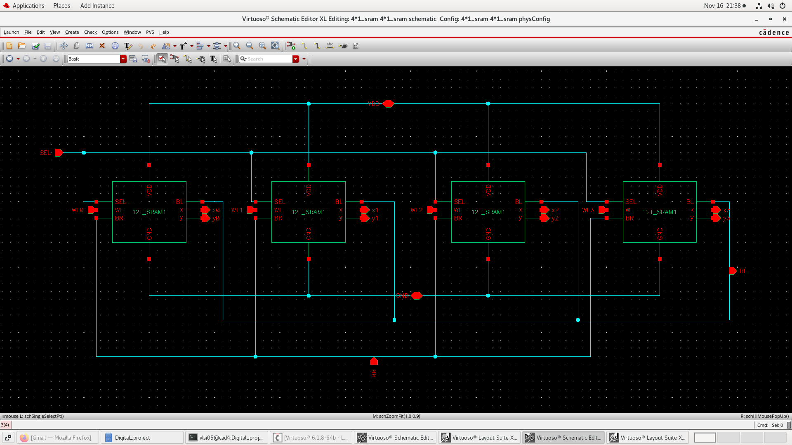
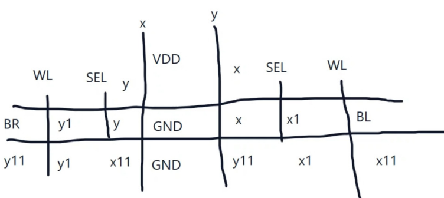
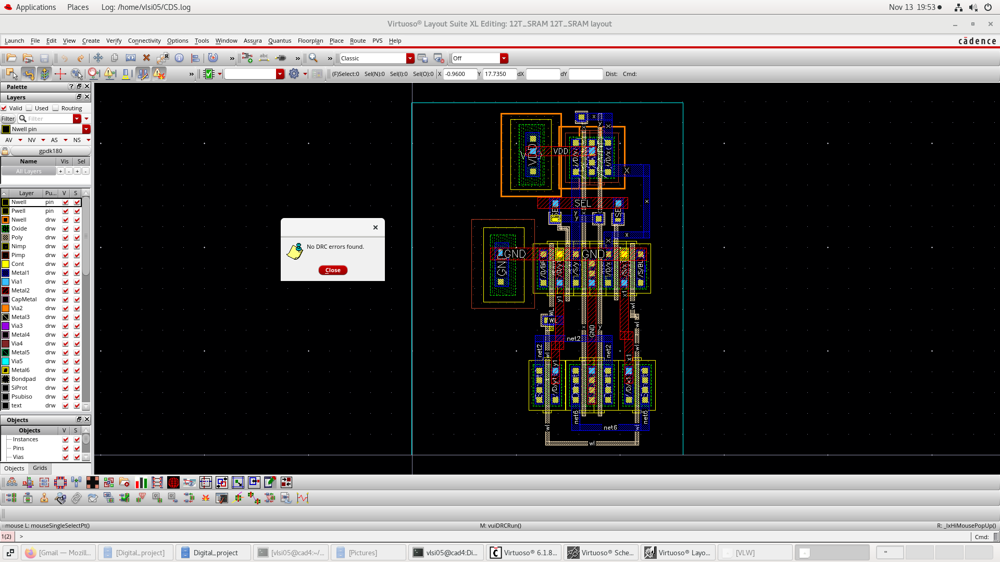

# 12T SRAM Design Using Cadence Virtuoso

\<p align="center">
&#x20; \
\</p>

\<h1 align="center">12T SRAM Design & Implementation\</h1>

\<p align="center">
&#x20; \<b>VLSI Design | SRAM Circuit Design | Cadence Virtuoso\</b>
\</p>

\<p align="center">
&#x20; \
&#x20; \
&#x20; \
\</p>

---

## 📌 Overview

This project presents the design and implementation of a **12-Transistor (12T) Static Random Access Memory (SRAM)** using Cadence Virtuoso.

The project covers SRAM schematic design, circuit simulation, functionality analysis, butterfly curve analysis, physical layout implementation, and verification using Design Rule Check (DRC) and Layout Versus Schematic (LVS).

The work demonstrates the application of VLSI design concepts in SRAM circuit development and physical implementation.

---

## 🎯 Project Objectives

- Design and implement a 12T SRAM cell using Cadence Virtuoso.
- Understand SRAM architecture and circuit operation.
- Implement a 4×1 SRAM configuration.
- Analyze SRAM functionality through simulation.
- Study butterfly curves for SRAM stability analysis.
- Develop the physical layout of the SRAM design.
- Perform DRC and LVS verification.

---

## 🛠️ Tools & Technologies

| Tool                            | Application                          |
| ------------------------------- | ------------------------------------ |
| Cadence Virtuoso                | Schematic and layout design          |
| Analog Design Environment (ADE) | Circuit simulation                   |
| DRC                             | Design rule verification             |
| LVS                             | Layout versus schematic verification |

---

## 🔄 Design Methodology

```text
       12T SRAM Cell Design
                |
                ▼
      Schematic Implementation
                |
                ▼
       Circuit Simulation
                |
                ▼
     Functional Verification
                |
                ▼
      Butterfly Curve Analysis
                |
                ▼
       4×1 SRAM Design
                |
                ▼
       Physical Layout
                |
                ▼
        DRC Verification
                |
                ▼
        LVS Verification
```

---

## 📊 Project Results & Visualizations

### 1. 12T SRAM Schematic

The schematic representation of the 12T SRAM cell designed using Cadence Virtuoso.

\<p align="center">
&#x20; \
\</p>

### 2. 4×1 SRAM Design

The 4×1 SRAM implementation.

\<p align="center">
&#x20; \
\</p>

### 3. SRAM Butterfly Curve

Butterfly curve representation for SRAM stability analysis.

\<p align="center">
&#x20; \
\</p>

### 4. SRAM Functionality Simulation

Simulation results demonstrating SRAM functionality.

\<p align="center">   \ \</p>

### 5. Final SRAM Layout

The final physical layout of the SRAM design implemented in Cadence Virtuoso.

\<p align="center">   \ \</p>

### 6. Initial Layout – LVS

Initial layout representation associated with LVS verification.

\<p align="center">   \ \</p>

### 7. DRC Verification

Design Rule Check verification of the SRAM layout.

\<p align="center">   \ \</p>

### 8. Additional Design Image

Additional SRAM project representation.

\<p align="center">
&#x20; \
\</p>

---

## ✅ Physical Verification

### Design Rule Check (DRC)

DRC is used to verify whether the physical layout satisfies the specified design rules.

### Layout Versus Schematic (LVS)

LVS is used to compare the physical layout with the schematic and verify circuit connectivity and consistency.

---

## 🚀 Applications of SRAM

- Processor cache memory
- Embedded memory systems
- High-speed digital circuits
- VLSI systems
- Memory subsystems

---

## 👨‍💻 Author

**Bhargav Jampana**

🎓 M.Tech – VLSI and Microelectronics
🏛️ Indian Institute of Information Technology Design and Manufacturing (IIITDM), Kurnool

---

## 🔗 Project Repository

\<p align="center">
&#x20; \<a href="[https://github.com/226ec1006-Bhargav/12T-SRAM-Cadence-Virtuoso](https://github.com/226ec1006-Bhargav/12T-SRAM-Cadence-Virtuoso)">
&#x20;   \
&#x20; \</a>
\</p>

---

\<p align="center">   \<b>12T SRAM Design | VLSI | Cadence Virtuoso\</b> \</p>

\<p align="center">   ⭐ Thank you for visiting this repository! \</p>
