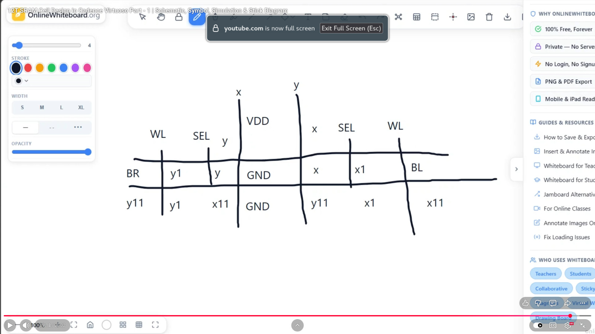
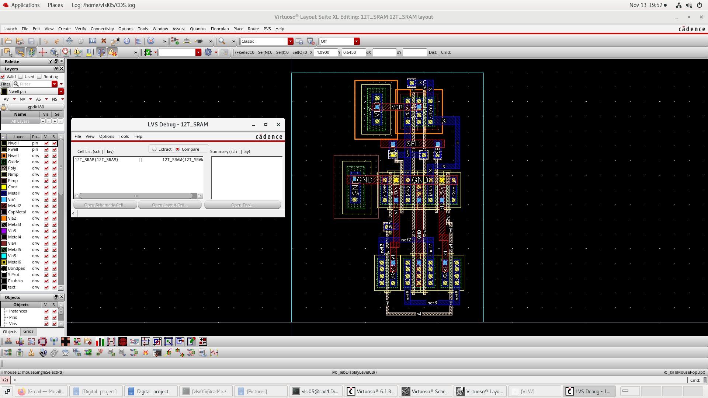

# 🔬 12T SRAM Design Using Cadence Virtuoso

<p align="center">
  
</p>

<h1 align="center">12T SRAM Design & Implementation</h1>

<p align="center">
  <b>VLSI Design | Cadence Virtuoso | SRAM Circuit Design</b>
</p>

<p align="center">
  
  
  
  
</p>

---

## 📌 Table of Contents

- [Project Overview](#-project-overview)
- [Objectives](#-objectives)
- [Tools Used](#-tools-used)
- [Design Workflow](#-design-workflow)
- [Project Images](#-project-images)
- [Verification](#-verification)
- [Applications](#-applications)
- [Author](#-author)

---

## 📖 Project Overview

This project presents the design and implementation of a **12-Transistor (12T) Static Random Access Memory (SRAM)** using Cadence Virtuoso.

The project involves SRAM schematic design, circuit simulation, SRAM functionality analysis, butterfly curve analysis, layout implementation, and physical verification using Design Rule Check (DRC) and Layout Versus Schematic (LVS).

The objective is to understand the design, operation, simulation, and verification of a 12T SRAM cell in the VLSI design environment.

---

## 🎯 Objectives

- Design a 12T SRAM cell using Cadence Virtuoso.
- Understand SRAM circuit architecture and operation.
- Implement a 4×1 SRAM configuration.
- Analyze SRAM functionality through simulations.
- Study the butterfly curve for SRAM stability analysis.
- Develop the SRAM physical layout.
- Perform DRC verification.
- Perform LVS verification.

---

## 🛠️ Tools Used

| Tool | Purpose |
|---|---|
| Cadence Virtuoso | Schematic and layout design |
| ADE | Circuit simulation |
| DRC | Design rule verification |
| LVS | Schematic and layout comparison |

---

## 🔄 Design Workflow

```text
SRAM Cell Design
       ↓
Schematic Implementation
       ↓
Circuit Simulation
       ↓
SRAM Functionality Analysis
       ↓
Butterfly Curve Analysis
       ↓
4×1 SRAM Implementation
       ↓
Physical Layout Design
       ↓
DRC Verification
       ↓
LVS Verification
```

---

## 🖼️ Project Images

### 1️⃣ 12T SRAM Schematic

The schematic representation of the 12-transistor SRAM cell designed using Cadence Virtuoso.

<p align="center">
  
</p>

### 2️⃣ 4×1 SRAM Design

The implementation of a 4×1 SRAM configuration.

<p align="center">
  
</p>

### 3️⃣ Butterfly Curve

Butterfly curve representation for SRAM stability analysis.

<p align="center">
  
</p>

### 4️⃣ SRAM Functionality

Simulation results illustrating SRAM functionality.

<p align="center">
  
</p>

### 5️⃣ Final Layout

The final physical layout of the SRAM design.

<p align="center">
  
</p>

### 6️⃣ Initial Layout LVS

Initial layout representation used during LVS verification.

<p align="center">
  
</p>

### 7️⃣ DRC Verification

Design Rule Check verification of the SRAM layout.

<p align="center">
  
</p>

### 8️⃣ SNN

Additional project design or simulation representation.

<p align="center">
  
</p>

---

## ✅ Verification

The SRAM layout verification process includes:

- **DRC (Design Rule Check):** Checks layout compliance with applicable design rules.
- **LVS (Layout Versus Schematic):** Checks consistency between the schematic and physical layout.

---

## 🚀 Applications

SRAM technology is widely used in:

- Cache memory in processors
- High-speed data storage
- Embedded memory systems
- Digital integrated circuits
- VLSI system design

---

## 👨‍💻 Author

**Bhargav Jampana**

🎓 B.Tech – Electronics and Communication Engineering

---

## 🔗 GitHub Repository

<p align="center">
  <a href="https://github.com/226ec1006-Bhargav/12T-SRAM-Cadence-Virtuoso">
    
  </a>
</p>

⭐ If you find this project interesting, consider giving the repository a star!
